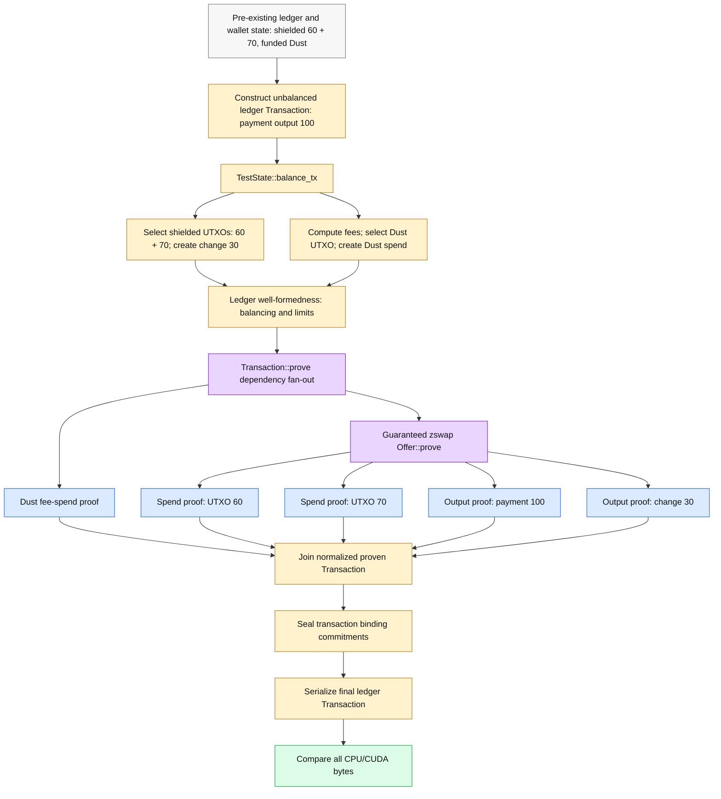
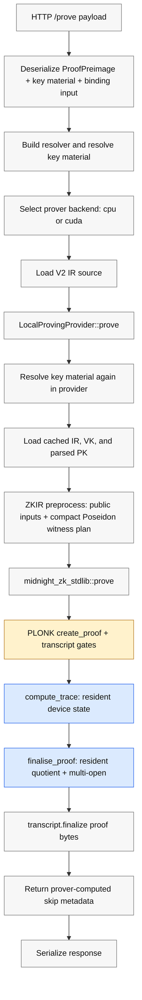

# proof-server proof flow graph

This document is the working map of the proof-server's GPU-owned CUDA path. It
distinguishes:

- protocol-ordered transcript gates that must stay sequential;
- implementation-owned host/device boundaries that should disappear;
- independent polynomial work that can be GPU-resident or scheduled on streams.

The primary optimization contract is one complete `zswap-transaction`. A
funded ledger/wallet state starts with shielded UTXOs of 60 and 70 plus a Dust
fee UTXO. The real ledger rebalancer funds a payment of 100, creates a 30-unit
change output, and adds one Dust spend for fees. The transaction is proved,
sealed, and serialized. The accepted repeat-5 baseline is CPU 3753.733 ms
versus CUDA 392.970 ms, `9.552x`, with every final transaction byte-exact. The
source artifact is
`benchmark-results/accepted-baselines/proof-backend-parity-zswap-transaction-sppark.json`.

## Primary Benchmark Flow

Funded wallet/ledger state and current-stack key generation are setup outside
the timed window. Everything from the unbalanced payment transaction through
final transaction serialization is inside the same CPU/CUDA contract.



`Transaction::prove` runs intents and guaranteed coins independently. Inside
the guaranteed zswap offer, both spends and both outputs are independent; the
Dust intent adds a fifth independent proof job. Results rejoin in protocol
order before transaction sealing and serialization. The timed scope includes
real shielded and fee balancing, structural well-formedness, all five proofs,
normal per-proof self-verification, sealing, and final serialization.

## Front Door

Source anchors:

- `/prove`: `proof-server/src/endpoints.rs`
- backend selection and deterministic RNG gate: `proof-server/src/versioned_ir.rs`
- local proving provider: `zkir/src/lib.rs`
- V2 ZKIR proving: `zkir/src/ir.rs`
- stdlib PLONK wrapper: `vendor/midnight-zk-stdlib-2.3.3/src/lib.rs`
- PLONK prover: `vendor/midnight-proofs-0.8.1/src/plonk/prover.rs`



Current ownership: request handling, compact terminal-Poseidon witness
generation, transcript ordering, proof serialization, and self-verification
remain CPU-owned. The specialized path expands that compact witness directly
into device-resident advice columns; it does not allocate or upload the old
host advice matrix. Stable proving-key material and proof polynomials are
device-owned from trace commitments through quotient construction, transcript
evaluations, and KZG multi-open. Parsed IR and proving keys are cached at the
wrapper boundary.

## PLONK Stage Graph

Solid edges are current call order. Gate nodes are Fiat-Shamir transcript
boundaries: the CPU must see ordered commitment/evaluation bytes there, but the
large polynomial data that produced those bytes should remain on device.

```mermaid
flowchart TD
    START["create_proof"]:::cpu
    HVK["hash VK into transcript"]:::gate
    INST["compute_instances: pad on CPU, coefficients resident on GPU"]:::mixed
    ADV["parse_advices: compact Poseidon witness + exact blinding RNG"]:::cpu
    ADVCOM["expand resident advice, scatter blinds, commit on GPU"]:::gpu
    C0["challenge(s) for advice phases"]:::gate
    THETA["theta challenge"]:::gate
    LPERM["lookup compress + deterministic permute + commit"]:::gpu
    BETA["beta challenge"]:::gate
    GAMMA["gamma challenge"]:::gate
    PCOM["resident permutation products + commits"]:::gpu
    LPROD["resident lookup products + commits"]:::gpu
    ARGJOIN["ordered argument commitment egress"]:::gate
    TRC["trash challenge"]:::gate
    TCOM["resident trash evaluate + commit"]:::gpu
    VCOM["vanishing commit_random"]:::mixed
    Y["y challenge"]:::gate
    A2C["resident advice lagrange_to_coeff"]:::gpu
    TRACE["ProverTrace with device handles"]:::gpu

    NUCOSET["resident coeff_to_extended for advice + instance"]:::gpu
    NUNUM["resident numerator: custom + permutation + lookup + trash"]:::gpu
    VCONST["resident divide, iFFT, split, blind, commit h limbs"]:::gpu
    X["x challenge"]:::gate
    WEVAL["device eval advice/fixed/instance; ordered scalar egress"]:::gpu
    VEVAL["device eval h/permutation/lookup/trash"]:::gpu
    QRY["CPU query metadata over resident handles"]:::mixed
    MOPEN["resident KZG q/f polynomials, Kate divisions, final MSMs"]:::gpu
    DONE["proof transcript bytes"]:::cpu

    START --> HVK --> INST --> ADV --> ADVCOM --> C0 --> THETA
    THETA --> LPERM --> BETA --> GAMMA
    GAMMA --> PCOM --> ARGJOIN
    GAMMA --> LPROD --> ARGJOIN
    ARGJOIN --> TRC --> TCOM
    TCOM --> VCOM --> Y --> A2C --> TRACE
    TRACE --> NUCOSET --> NUNUM --> VCONST --> X --> WEVAL --> VEVAL --> QRY --> MOPEN --> DONE

    classDef cpu fill:#f7f7f7,stroke:#777,color:#111;
    classDef mixed fill:#fff2cc,stroke:#b7791f,color:#111;
    classDef gate fill:#fee2e2,stroke:#dc2626,color:#111;
    classDef gpu fill:#dbeafe,stroke:#2563eb,color:#111;
```



## Implemented Residency Graph

This is the same flow recast as the architecture now implemented for domains of
at least `2^15` rows. Red nodes are the small CPU transcript gates. Blue nodes
run over device handles and retain their inputs and outputs across stages.


This is no longer a CPU prover calling CUDA for isolated MSM/FFT/vector leaves.
The CPU owns transcript order and byte-exact proof serialization; the GPU owns
the polynomial store and heavy proof arithmetic between transcript gates.

For smaller domains, resident finalise, argument ownership, and multi-open use
one shared eligibility policy. The default remains `2^14`. An environment
override can lower it to `2^13`, where permutation and lookup construction run
sequentially, but that candidate remains opt-in because CPU-first repeat parity
still fails at later deterministic seeds.

## Parallel Groups

These are the safe scheduling groups. Ordered transcript writes remain
deterministic even when their producer work overlaps.

```mermaid
flowchart TD
    A["After key context exists"]:::gate
    A --> B1["fixed/key material already resident"]:::gpu
    A --> B2["public instance column upload"]:::gpu
    A --> B3["witness/advice column upload"]:::gpu

    C["After advice values are available"]:::gate
    C --> C1["advice column MSMs"]:::gpu
    C --> C2["lagrange-to-coeff transforms"]:::gpu
    C --> C3["lookup input compression where theta is known"]:::gpu

    D["After beta/gamma"]:::gate
    D --> D1["permutation grand products"]:::gpu
    D --> D2["lookup product grand products"]:::gpu

    E["After y"]:::gate
    E --> E1["custom gate numerator rows"]:::gpu
    E --> E2["permutation numerator rows"]:::gpu
    E --> E3["lookup numerator rows"]:::gpu
    E --> E4["trash numerator rows"]:::gpu

    F["After x"]:::gate
    F --> F1["advice/fixed/instance evals"]:::gpu
    F --> F2["permutation evals"]:::gpu
    F --> F3["lookup evals"]:::gpu
    F --> F4["trash evals"]:::gpu
    F --> F5["vanishing evals"]:::gpu

    G["Inside multi_open after opening challenges"]:::gate
    G --> G1["point-set q_polys"]:::gpu
    G --> G2["Kate divisions"]:::gpu
    G --> G3["f_poly/final_poly inner products"]:::gpu
    G --> G4["final commitment MSMs"]:::gpu

    classDef gate fill:#fee2e2,stroke:#dc2626,color:#111;
    classDef gpu fill:#dbeafe,stroke:#2563eb,color:#111;
```



## Primary Accepted Result

The only headline optimization gate is:

| Contract | CPU | CUDA | Result |
| --- | ---: | ---: | ---: |
| `zswap-transaction`: 2 spends + 2 outputs + Dust fee spend | 3753.733 ms | 392.970 ms | **9.552x** |
| Deterministic seeds | 5 | 5 | exact |
| Final serialized transaction | 23474-23476 bytes | 23474-23476 bytes | exact |
| H2D per iteration | 0 | 94.444 MiB | measured |
| D2H per iteration | 0 | 23.529 MiB | measured |

Source:
`benchmark-results/accepted-baselines/proof-backend-parity-zswap-transaction-sppark.json`.
The gate creates an unbalanced ledger transaction, runs the repository's actual
`TestState::balance_tx`, selects both shielded UTXOs and one Dust fee UTXO,
checks structural well-formedness, proves five jobs through `Transaction::prove`,
self-verifies each proof, seals transaction bindings, and compares the complete
serialized transaction. Current-stack keys and funded ledger/wallet state are
setup outside the timing window.

The ratio is the fair same-process result for this run. Absolute CUDA latency
improved from 467.749 ms in the previous accepted artifact to 392.970 ms. The
hybrid sppark reducer keeps weighted window integration on device and returns a
narrow batch-partial array for the final host fold. Future comparisons must
track absolute latency and transfer scope as well as the CPU/CUDA ratio.

The zswap and Dust relation sources retain their existing semantics, but this
migration gate uses generated current-stack keys and the explicit current
prover. Normal production key dispatch still uses compatibility keys until the
bundles are regenerated and migrated.

### Diagnostic gates

The old fixtures remain useful only to isolate causes:

- `zswap-spend`: 1157.565 ms CPU versus 271.581 ms CUDA (`4.262x`), with
  18.008/0.861 MiB H2D/D2H. Deterministic live-slot compaction admits its
  401 cached intermediates without raising the 256-slot CUDA capacity.
- `zswap-output`: the k=14 relation now uses the coherent resident finalise,
  argument, and multi-open policy. It remains byte-exact.
- `dust-spend`: the accepted result retains the exact leaf path. The current
  resident candidate passed short exact runs, but failed CPU-first repeat
  parity after the cursor-alias fix and remains opt-in.
- `hash-chain-v2`, rounds 2048: 3528.646 ms CPU versus 226.400 ms CUDA
  (`15.586x`). It demonstrates the large-domain resident architecture but is
  not the product optimization score.
- The k=12 hash-chain safety gate remains byte-exact at `1.114x`.

The main gate combines product-circuit blockers, wallet and fee balancing,
multi-proof scheduling, binding, and final transaction serialization in one
client-relevant number. No isolated-fixture or synthetic improvement is
reported as the headline speedup.

The previous device-side collection is
`benchmark-results/gpuprof-nsys-resident-accepted-20260710`. Its measured CUDA
iteration is 317.150 ms; proofscope reconciles with zero error and zero unknown
labels. The trace reports 183.0 ms of kernels across 2441 launches. Its static
lint points first at sppark MSM sort grid underfill and register-limited
accumulate/integrate kernels. It predates direct resident advice and is no
longer a matching attribution trace. Recollect before using device-stage
percentages; the trace-wide 4.3 s table also includes warmup and one-time
context initialization, so it must not replace the parity JSON.

## Large-Domain Diagnostic Resident State

The large-domain CUDA path now keeps these objects on device:

- a key-scoped numerator/MSM context with SRS bases, fixed columns,
  permutation polynomials, selector data, and expression graphs;
- proof-scoped advice and instance arenas across basis changes;
- lookup compressed/permuted columns and lookup product polynomials;
- permutation and trash product polynomials;
- extended-domain cosets and the accumulated numerator;
- quotient limbs, blinding, h combination, transcript evaluation inputs;
- KZG multi-open q/f polynomials and the final opening MSM inputs.

CPU egress is ordered and narrow: commitment points and evaluation scalars
needed by Fiat-Shamir, then final proof bytes. Whole polynomials are not
downloaded in the normal resident path. Debug modes can restore mirrors for
byte-by-byte internal checks.

For the large hash-chain diagnostic, the remaining H2D budget is 56.010 MiB per
proof: the compact 16 MiB Poseidon witness plus other proof-scoped
coefficient/context uploads. The old 32 MiB host advice matrix is no longer
transferred. Its 0.009 MiB D2H budget demonstrates that the old bidirectional
polynomial bridge is gone. The primary zswap gate now reports 94.444/23.529 MiB
H2D/D2H per complete transaction. The remaining whole-polynomial traffic is
owned by the non-resident k=13 Dust proof, while part of the H2D budget now
explicitly belongs to residual MSMs moved from CPU to CUDA.

## Scheduling Policy

The implementation follows actual dependencies rather than old CPU call order:

- the main transaction exposes its Dust intent and guaranteed zswap offer
  independently through `Transaction::prove`;
- the zswap offer exposes both spends and both outputs independently, producing
  five proof jobs in total with the Dust fee spend;
- the CUDA provider schedules those jobs as real blocking tasks after assigning
  deterministic RNG streams in protocol order;
- proof execution lanes own disjoint sppark contexts, streams, buckets, cursors,
  and events, so independent proofs no longer serialize behind the old C++
  process-wide MSM mutex;
- calls within one proof retain a lane lock because scalar-preparation streams
  are still shared; a per-context lock plus private primary streams passed short
  gates but failed the 20-iteration parity stress gate;
- permutation and lookup product construction run concurrently after beta and
  gamma are available;
- same-base MSM work uses six internal lanes for k=13/14/15 on the RTX 4090;
- proof-key affinity reuses the same proof-owned execution lane across warm
  iterations, avoiding repeated key/numerator context uploads; separate proof
  lanes can overlap while same-proof dispatch remains serialized for correctness;
- resident Lagrange batches use exact corrected scrambling by default, avoiding
  the pathological bucket imbalance measured in direct device batches;
- the large-domain resident diagnostic disables the old process-wide leaf mutex
  because its contexts own their scratch state;
- a reader/exclusive proof permit gives CUDA exclusive ownership of the global
  backend state while still allowing CPU proofs to coexist when no GPU proof is
  active; cross-proof CUDA overlap waits for explicit streams and memory policy;
- commitment and evaluation results are written to the transcript in protocol
  order regardless of producer completion order.

The default policy intentionally keeps two measured regressions off:
standalone Poseidon preprocessing remains on CPU, and standalone canonical
lookup sort remains off. The resident lookup permutation uses its deterministic
device implementation.

## Wrapper Work

The HTTP/provider path is part of the fair latency contract:

- parsed IR is cached;
- serialized prover-key buffers are shared across resolver clones, so the hot
  cache uses immutable buffer identity; a new buffer at the same location still
  takes the full raw-byte equality path before reuse, so changed key material
  cannot alias a cached object;
- prover-computed skip metadata is returned directly instead of replaying the
  preimage after proof generation;
- the proof is still self-verified before the server returns it.

On a warm k=17 run, parsed prover-key loading no longer scans or clones the
unchanged serialized key buffer. Self-verification is only about 2-3 ms and was
not removed to inflate the speedup.

## Negative Results

Keep these results so future work does not rediscover the same local maxima:

- CUB batched radix lookup permutation was byte-exact but slower than the serial
  per-lookup device schedule.
- Overlapping trash and vanishing-random commitments was byte-exact but
  regressed the proof; that scheduler was removed.
- MSM window sizes 11 and 12 regressed the real k=15 spend relative to its
  size-selected window 10; earlier large-domain window 11/13, sort divisor 2/4,
  and eight-lane experiments also regressed. Per-context configuration must
  preserve these domain-specific choices.
- Four sort windows per cooperative launch and a persistent all-window sort
  kernel were byte-exact but slower than two-window grouped launches on the
  complete transaction; they are retained only as diagnostic config options.
- Four/five/eight internal batch lanes, same-proof context overlap, and lazy
  persistent C++ workers all produced attractive short-run timings but failed
  longer proof-validity gates. Six lanes with per-dispatch workers is retained.
- Lowering the residual-MSM floor from 100000 to 8192 moved the remaining
  k=13/14/15 MSMs to CUDA and is retained. A 4096/5551 floor regressed.
- Lowering the unfiltered-MSM floor from 32768 to 16384 avoided host compaction
  and reused resident full-base contexts. An 8192 floor reached about 435 ms in
  short runs but failed the 20-iteration parity gate and is rejected.
- Forcing two accumulator blocks per SM exposed sppark's shared cursor race;
  lane-unique cursors fixed correctness, but both the two-wave and co-resident
  launch variants regressed the complete transaction. Original launch bounds
  are retained.
- Corrected weighted MSM row integration is retained for k=14-18. The safe
  reducer downloads only the small batch-partial array and weighted window rows
  for a narrow host fold; repeat-5 moved CUDA from 467.749 ms to 392.970 ms.
  Fully device-side final collection reached 373-379 ms in short runs but
  produced invalid spend proofs in longer and CPU-first cache-lifecycle gates,
  so it is rejected until its state ownership is fixed.
- Resident ragged lookup-input MSM is implemented behind
  `MIDNIGHT_GPU_LOOKUP_RESIDENT_RAGGED=on`: GPU suffix statistics, stable fused
  scalar/base compaction, cached full-SRS base offsets, and exact point parity.
  On this k=14/15 transaction the three live MSMs contain only 12.8K-27.9K
  scalars total and take 23-34 ms per proof; complete CUDA latency regressed to
  roughly 412-421 ms. The faster CPU-filtered mixed path remains the default.
- Direct resident Lagrange MSM batches exhibited pathological bucket imbalance.
  Exact corrected scrambling reduced zswap spend from about 498 ms to 272 ms
  and is retained.
- Standalone advice MSM, numerator, prefix, inversion, and multi-open helpers
  moved host/device boundaries without preserving residency and saturated near
  the old 2x bridge.
- A parallel CPU rational-inversion fallback did not improve the target
  workload and was removed; only the useful all-trivial assignment fast path
  remains.
- A mixed k=14 layout failed when finalise and lookup-product/multi-open
  thresholds diverged. One shared policy is required. The k=13 candidate also
  exposed an sppark batch-addition bug where proof lanes aliased eight global
  device cursors; the cursor namespace is now lane-unique, with final stress
  acceptance pending.

## Remaining ROI

At the accepted 3753.733 ms CPU time, the main-gate targets are:

| Target | Maximum CUDA time | Required change from 392.970 ms |
| --- | ---: | ---: |
| 8x | 469.217 ms | achieved with 76.247 ms headroom |
| 10x | 375.373 ms | reduce 17.597 ms |
| 15x | 250.249 ms | reduce 142.721 ms |
| 20x | 187.687 ms | reduce 205.283 ms |

The work order is therefore product-architecture first:

1. Complete the post-cursor-fix stress gate for k=13 residency, followed by
   repeat-5 CPU-first byte parity on the complete transaction; keep k=14 as the
   default boundary until it passes.
2. Replace five synchronous prover clients with a transaction-level scheduler
   that batches ready MSM, NTT, argument, and multi-open work by dependency wave.
3. Keep exact Blake2b transcript states on device and extend the sppark fork
   with persistent per-k batch plans, downloading only final proof bytes.

Tiny leaf tuning and synthetic-fixture wins do not count unless this exact
final-transaction gate improves and remains byte-exact.

## Verification Commands

```bash
cargo build -p midnight-proof-server --release \
  --features deterministic-test-rng,gpu-blitzar \
  --bin proof-backend-parity

LD_LIBRARY_PATH="$(find target/release/build -path '*/out/*.so' \
  -printf '%h\n' | sort -u | paste -sd:)" \
target/release/proof-backend-parity \
  --backend both --fixture zswap-transaction \
  --iterations 3 --warmup 1 --seed 24301

scripts/gpuprof.sh parity --repeat 3 \
  --json benchmark-results/gpuprof-parity-zswap-transaction-candidate.json

python3 -m unittest discover -s scripts/proofscope/tests
```

The accepted baseline moves only after the complete repeat-3 transaction is
exact, the rebalance/fee shape and timing scope are unchanged, and
transfer/synchronization accounting does not regress.
